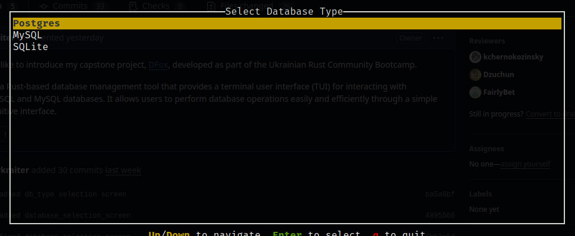
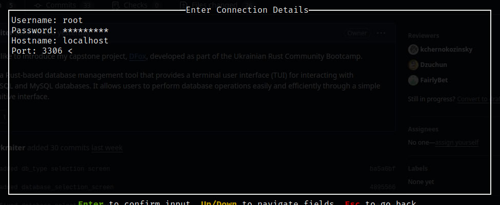
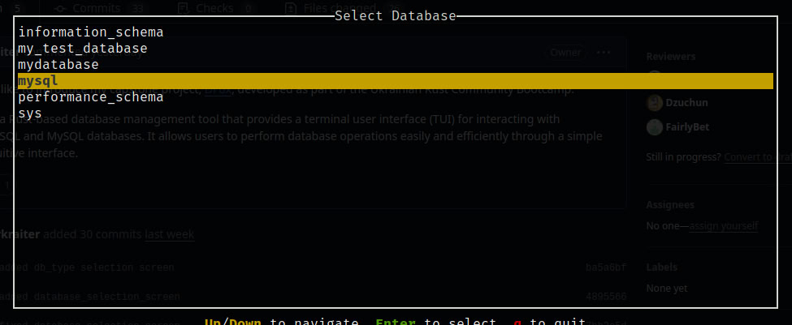
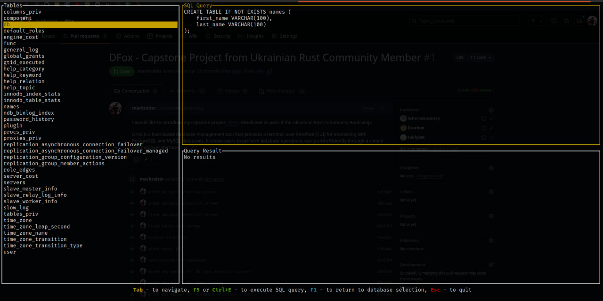
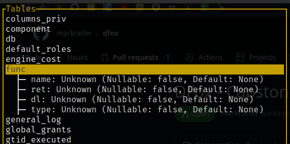
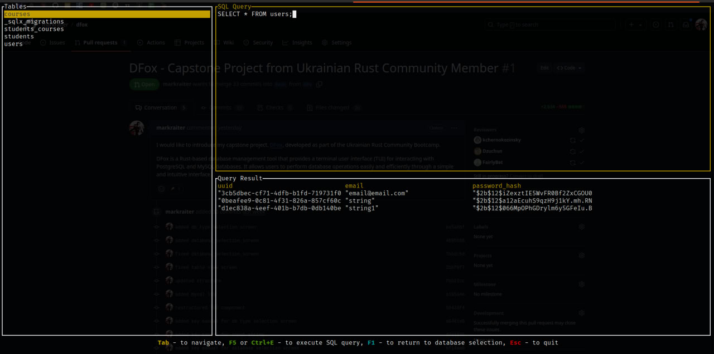
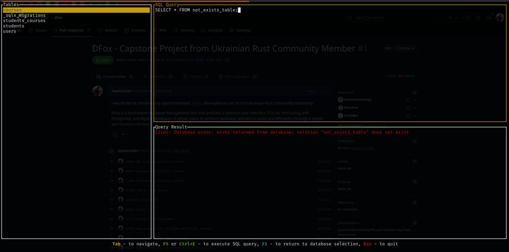

<p align="center">
  
</p>

# DFox - ⚡️ Blazing Fast Terminal Database Manager

<p align="center">
  <a href="https://github.com/0xataru/dfox/actions/workflows/ci.yml"></a>
  <a href="https://codecov.io/gh/0xataru/dfox"></a>
  <a href="https://scorecard.dev/viewer/?uri=github.com/0xataru/dfox"></a>
  <a href="https://github.com/0xataru/dfox/releases/latest"></a>
  <a href="LICENSE"></a>
  <a href="https://ratatui.rs/"></a>
</p>

**DFox** is a Rust-based database management tool that provides a terminal user interface (TUI) for interacting with PostgreSQL and MySQL databases.
It allows users to perform database operations easily and efficiently through a simple and intuitive interface.

## Features

- Connect to multiple database types: PostgreSQL, MySQL, (SQLite still in development).
- User-friendly terminal interface for managing database connections and performing CRUD operations.
- Dynamic rendering of database schemas and table data.
- Easily extendable for additional database types and features.
- Built-in debug logging system for troubleshooting.

## Project Structure

The project is organized as a Cargo workspace consisting of two main components:

- **dfox-core**: The core library responsible for database operations. It includes implementations for MySQL, PostgreSQL, and SQLite clients, as well as data models and error handling.
- **dfox-tui**: The command-line interface for user interaction. It contains the main functions for launching the application, along with UI components and event handlers.

## Debug Logging

DFox includes a comprehensive logging system to help with troubleshooting and development. By default, logging is disabled for better performance. To enable debug logging:

1. Create a `.env` file in the project root directory:
```bash
# .env file
RUST_LOG=debug
```

2. Run the application as usual. Debug logs will be written to `dfox-debug.log` in the current directory.

3. You can also view the event log directly in the application by pressing **F12** while using the interface.

### Log Levels
- `off` - No logging (default)
- `error` - Only errors
- `warn` - Warnings and errors
- `info` - General information, warnings, and errors  
- `debug` - Detailed debugging information (recommended for troubleshooting)
- `trace` - Very verbose logging

Example `.env` configurations:
```bash
# For normal usage (default)
RUST_LOG=off

# For basic error tracking
RUST_LOG=error

# For troubleshooting
RUST_LOG=debug

# For development
RUST_LOG=trace
```

## How It Works

1. **Database Type Selection**  
   Upon starting the application, the user is presented with a menu to select the database type (PostgreSQL, MySQL, or SQLite). Use the up/down keys to navigate and Enter to confirm your choice.  
   

2. **Connection Input Screen**  
   After selecting the database type, the user is prompted to input the connection details such as hostname, port, username, and password.  
   

3. **Database Selection**  
   Once connected, a list of available databases is displayed. The user can choose the database to interact with.  
   

4. **Table View**  
   The application dynamically renders the list of tables available in the selected database.  
   

5. **Describe Table**  
   The user can select a table to view its schema, displayed in a tree-like structure, including column names, types, and constraints.  
   

6. **Query Execution and Results**  
   The user can execute SQL queries and view the results in the TUI.  
   

7. **Error Handling**  
   If there is an error with the query or database operation, an error message is displayed in the interface.  
   

## Keyboard Shortcuts

Press **?** (or **F2**) in the app for the full list, generated from your keymap.
**Space** opens a command menu outside text fields.

### General Navigation
- **Tab** / **Shift+Tab** - Move between the tables, the query editor and the results
- **↑/↓** - Move in lists and results
- **←/→** - Scroll the result columns
- **Page Up/Page Down** - Scroll a page
- **Home/End** - Jump to the first/last row

### Query Operations
- **F5** or **Ctrl+E** - Run the query
- **Ctrl+C** - Cancel the running query, or copy the selected row
- **Ctrl+A** - Copy all rows

### Interface Controls
- **F1** - Back to the database list
- **Ctrl+T** - Next theme
- **F12** - Event log
- **Esc**, **q** or **Ctrl+Q** - Quit (asks first while connected)

### SQL Editor
- Typing inserts at the cursor; **Enter** starts a new line
- **Backspace** deletes, joining lines at the start of a line

## Configuration

dfox reads `config.toml` from `~/.config/dfox/` (or `$XDG_CONFIG_HOME/dfox/`,
`%APPDATA%\dfox\` on Windows, or the directory in `DFOX_CONFIG_DIR`). Every
setting is optional:

```toml
theme = "dfox"        # dfox, tokyo-night, catppuccin-mocha, catppuccin-latte,
                      # gruvbox, nord, high-contrast, or a file in themes/
keymap = "standard"   # or "vim": hjkl, g/G, Ctrl+D/Ctrl+U outside text fields
animations = true     # false shows still symbols instead of spinners
icons = "auto"        # "nerd" for Nerd Font glyphs, "ascii" for plain text
row_limit = 100000    # rows kept from a query; the rest are read and dropped

[keys]                # replaces all keys of an action
execute = ["f5", "ctrl+r"]
```

A theme file in `themes/<name>.toml` sets any colours as `"#rrggbb"` and takes
the rest from the theme it `extends`:

```toml
extends = "nord"
accent = "#ff9e3b"
border_focus = "#ff9e3b"
```

The colours are `bg`, `surface`, `surface_alt`, `border`, `border_focus`,
`text`, `text_dim`, `accent`, `accent_alt`, `success`, `warning`, `danger`,
`null`, `number`, `string`, `keyword`, `comment` and `selection`. On terminals
without true colour, dfox picks the nearest of 256 or 16 colours.

## Installation

### Prebuilt binaries

Download the archive for your platform from the
[latest release](https://github.com/0xataru/dfox/releases/latest) (Linux x86_64,
macOS Intel and Apple silicon, Windows x86_64), extract it and run `dfox-tui`.
Each release includes a `SHA256SUMS` file to verify the download.

### From source

You need stable [Rust](https://www.rust-lang.org/tools/install):

```bash
git clone https://github.com/0xataru/dfox.git
cd dfox
cargo build --release
./target/release/dfox-tui
```

## Usage

Run the TUI from a source checkout with:

```bash
make run    # or: cargo run --bin dfox-tui
```

## Contributing

Contributions are welcome! Please read [CONTRIBUTING.md](CONTRIBUTING.md) for the
development workflow, how pull requests are reviewed and how releases are made.
Notable changes are listed in the [changelog](CHANGELOG.md).

Please report security issues privately, as described in [SECURITY.md](SECURITY.md).
This project follows a [code of conduct](CODE_OF_CONDUCT.md).

## Acknowledgments

Thanks to the [Ukrainian Rust Community](https://github.com/rust-lang-ua) for their incredible support and resources.
